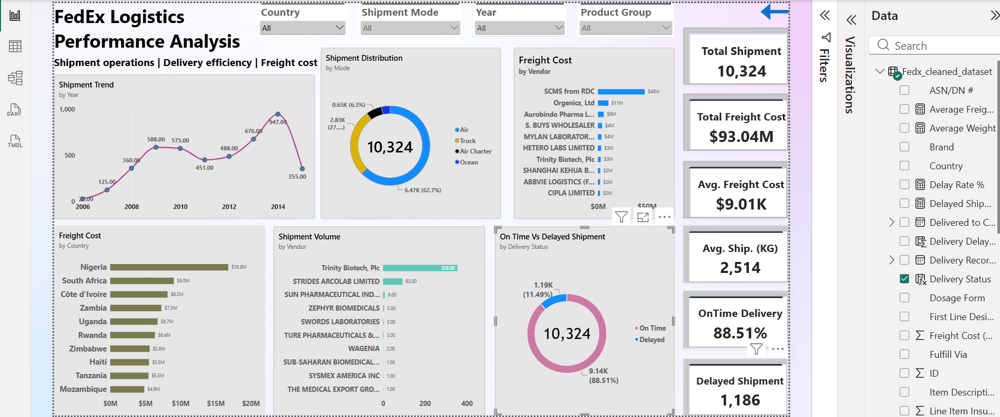

# FedEx Logistics Performance Analysis

## Project Overview

This project focuses on analyzing FedEx logistics and shipment performance using Python and Microsoft Power BI.

The objective is to understand shipment operations, delivery performance, delays, shipment modes, vendor performance, and freight costs through data cleaning, analysis, and interactive visualization.

## Tools & Technologies

- Python
- Pandas
- Google Colab
- Microsoft Power BI
- DAX
- Excel / CSV

## Dataset

The project uses the SCMS Delivery History Dataset, containing shipment and logistics information.

The dataset includes information related to:
- Shipment modes
- Vendors
- Delivery dates
- Freight costs
- Shipment weights
- Delivery performance

## Data Cleaning & Preprocessing

Data cleaning and preprocessing were performed using Python in Google Colab.

Key steps included:

- Identifying and handling missing values.
- Converting date columns into appropriate date formats.
- Converting Weight and Freight Cost columns into numeric data types.
- Handling inconsistent and missing date entries.
- Preparing the cleaned dataset for Power BI visualization.

Additional calculated columns were created:

- Delivery Status
- Delivery Delay
- PO Sent Year

## Power BI Dashboard

An interactive, one-page Power BI dashboard was developed to analyze logistics performance.

The dashboard focuses on:

- Shipment performance
- Delivery delays
- Shipment mode analysis
- Vendor-wise shipment distribution
- Freight cost analysis

DAX measures were created to calculate shipment records and delayed shipment records.

### Dashboard Preview

## Key Business Insights

The dashboard helps identify:

- Shipment distribution across different vendors.
- Shipment volume across different transportation modes.
- Delivery delays and on-time shipment performance.
- Freight cost patterns.
- Areas where logistics operations may require improvement.

## Project Files

| File | Description |
|---|---|
| Data_Cleaning.ipynb | Python data cleaning notebook |
| FedEx_Cleaned_Data.csv | Cleaned dataset |
| FedEx_Dashboard.pbix | Power BI dashboard |
| Dashboard_Screenshot.png | Dashboard preview |

## Project Demonstration

YouTube Video: https://youtu.be/9m2GzEnxJKo?si=TBiiVXbfXfR9J7Db

## Conclusion

This project demonstrates an end-to-end data analytics workflow, starting with data cleaning and preprocessing in Python and progressing to interactive dashboard development in Power BI.

It provides insights into logistics operations and demonstrates how data analytics can support business decision-making.
